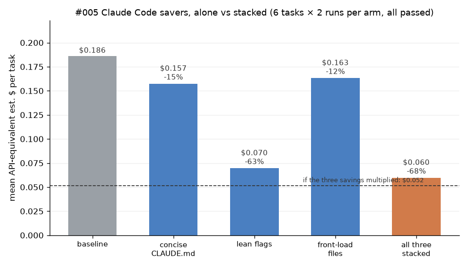

# #005 Stack the top savers (Claude Code CLI)

**Question.** Three cost savers each worked alone in earlier experiments: a concise ~620-byte CLAUDE.md (#004, −10%), lean flags `--strict-mcp-config --disable-slash-commands` (#007/#021, halved fixed overhead), and front-loading the file path + contents into the prompt (#015, −13.5%). Run on the same tasks, do the savings add up, multiply, or cancel?

**Short answer.** 6 tasks × 5 arms × 2 reps = **60 runs, all passed, no test file touched.** Alone, the savers cut mean API-equivalent est. cost by **15% (CLAUDE.md), 63% (lean flags), 12% (front-load)**. Stacked, they cut it **68%** ($0.186 → $0.060 per task). That is **less than the multiplicative prediction (72%, $0.052)** and well short of adding the percentages (90%). They don't cancel, but they overlap: lean flags do almost all the work, and the other two add only ~14% on top of lean ($0.070 → $0.060). On one task (N03_csv) stacking cost *more* than lean alone ($0.119 vs $0.098).

## Setup
- Claude Code 2.1.300, `claude-opus-5-5`, default effort, Pro sign-in. Headless `claude -p … --output-format stream-json --verbose --dangerously-skip-permissions --no-session-persistence` via `scripts/harness/run_cc.py` (copy of `_harness/run_cc.py`); fresh temp copy of the 14-package `SUITE14` fixture per run.
- Tasks (same as #015): N01_median, N02_duration, N03_csv, T05_stale, T07_multihunk, T10_replace_all. Pass = `cd <pkg> && node test.js` exits 0 and no test.js/run_all.js changed.
- Arms (`scripts/make_jobs.py`):

| Arm | Prompt | CLAUDE.md | Flags |
|---|---|---|---|
| baseline | bare bug report (#015 "bare") | none | default config (`--no-mcp-strict`: loads the account's 3 claude.ai connectors, 270 tools, 63 slash commands) |
| claude_md | bare | `short619.md` from #004 (621 B) | default |
| lean | bare | none | `--strict-mcp-config --disable-slash-commands` (23 tools, 0 slash commands) |
| frontload | #015 front-loaded (path + check cmd + file contents) | none | default |
| stacked | front-loaded | short619.md | lean |

- n = 6 tasks × 2 reps per arm = 12 runs/arm, 60 total; 5 at a time, rep 1 then rep 2, 2026-10-14 ~23:25–23:30 UTC. Arms are interleaved within each task, so they share the same cache-warmth conditions.
- **Est. $ = Claude Code's own `total_cost_usd` (list API price): an API-equivalent estimate; Pro isn't billed per token.**

## Exact commands
```bash
source /workspace/tools/setup.sh
python3 scripts/make_jobs.py
scripts/harness/driver_cc.sh scripts/jobs.txt 5 results/driver.log
/workspace/tools/mlenv/bin/python scripts/analyze.py
```

## Results (means over 6 tasks × 2 reps)
| Arm | Passed | Est. $ / task | Δ cost | Total tokens | Cache-write tokens | Output tokens | Model calls | Wall s |
|---|---|---|---|---|---|---|---|---|
| baseline | 12/12 | $0.186 | — | 110,336 | 19,112 | 745 | 4.67 | 17.9 |
| claude_md | 12/12 | $0.157 | −15.4% | 98,375 | 16,528 | 440 | 4.17 | 15.8 |
| lean | 12/12 | $0.070 | −62.6% | 54,918 | 5,744 | 691 | 4.42 | 15.9 |
| frontload | 12/12 | $0.163 | −12.3% | 57,540 | 17,625 | 711 | 2.67 | 14.9 |
| **stacked** | 12/12 | **$0.060** | **−67.9%** | 32,180 | 6,056 | 300 | 2.33 | 9.6 |

Stacked-saving predictions from the single-saver numbers: simple sum 90.3%, multiplicative (1−Π(1−sᵢ)) **72.3%**, observed **67.9%**.

Per task, stacked saving: N01 72%, N02 73%, **N03 50%**, T05 74%, T07 71%, T10 73% (`results/per_task.csv`).

Files: `results/runs.csv` (one row per run), `results/summary.csv`, `results/per_task.csv`, raw stream-json in `results/raw/`, chart `results/chart.png`.



## Caveats
- **The lean-flag saving is specific to this account's setup.** The baseline loads three claude.ai connectors (one with ~200 tools) and 63 slash commands, which costs ~13K extra cache-write tokens per run. With fewer connectors, lean flags would save less, and the other two savers would matter relatively more. #007 measured "halved fixed overhead" on a different configuration.
- Why it's sub-multiplicative: front-loading pastes files into the prompt, which become fresh cache writes (the expensive token type). On the fat baseline that cost is hidden by the large prefix; on the lean prefix it's a bigger share. N03 (the largest pasted file) is where stacked lost to lean.
- 2 reps per cell. Claude's run-to-run variance was ~1% in #010b, but some cells here moved more between reps (e.g. lean N01 $0.059 → $0.104), so treat differences under ~5 points as noise. 68% vs 72% is suggestive, not proven.
- Tiny JS packages, one model, default effort. Front-loading would save more in a big repo, where exploring is expensive.
- The concise CLAUDE.md cut output tokens 41% and final replies got shorter; I didn't grade answer quality beyond pass/fail and tests left untouched.
